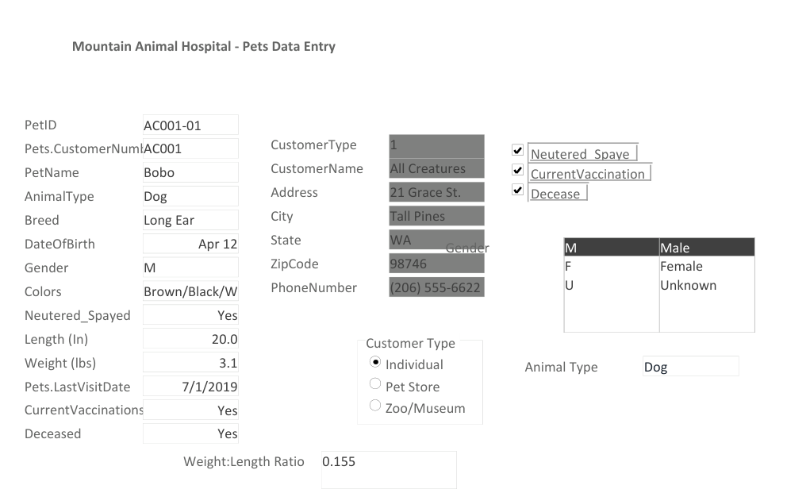
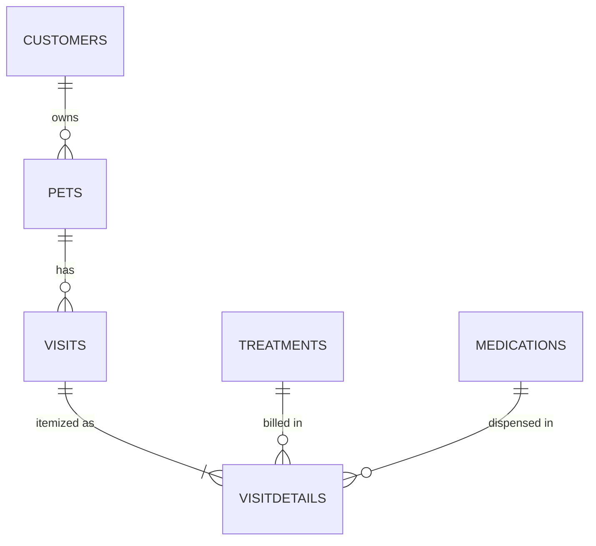
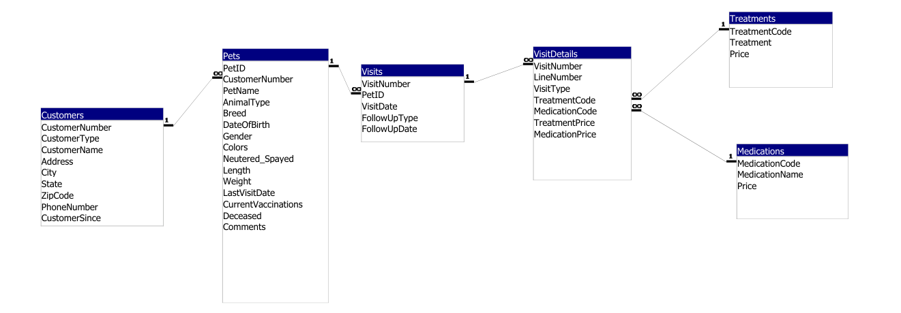

# Veterinary Clinic Database (Microsoft Access)

A patient records system for a mock veterinary practice ("Mountain Animal Hospital") built in Microsoft Access. Staff can look up a pet together with its owner, enter new patient records through a data entry form, and work with standardized customer categories.

**Tools:** Microsoft Access · Access forms (combo box, list box, option group, calculated control) · Access SQL (select and update queries)

## What I built

The tables and sample data came with the course. My work was the user interface and the queries on top of them:

- **Pets Data Entry Form.** A single screen for entering a pet and seeing its owner's details. It's based on a query that joins `Pets` to `Customers`, so owner information appears automatically.
  - **Animal Type combo box** that looks up values from an `Animals` lookup table, so entries stay consistent
  - **Gender list box** (M / F / U) and **Customer Type option group** (Individual / Pet Store / Zoo-Museum)
  - **Check boxes** for neutered/spayed, current vaccinations and deceased
  - **Calculated Weight:Length ratio** control
- **`Pets and Owners` query.** Inner join of `Customers` and `Pets` on `CustomerNumber`. It's the record source for the form.
- **`CustomerType` update query.** Replaces the numeric customer-type code with a readable label (`"3"` → `"Zoo/Museum"`).

## Data model

7 tables. Every relationship enforces referential integrity.

| Table | Rows | Key |
|---|---:|---|
| `Customers` | 49 | `CustomerNumber` |
| `Pets` | 130 | `PetID` → `Customers` |
| `Visits` | 86 | `VisitNumber` → `Pets` |
| `VisitDetails` | 145 | (`VisitNumber`, `LineNumber`) → `Visits`, `Treatments`, `Medications` |
| `Treatments` | 36 | `TreatmentCode` |
| `Medications` | 43 | `MedicationCode` |
| `Animals` | 35 | Lookup list of animal types |

## Queries

See [`queries.sql`](queries.sql) for the Access SQL.

## How to run

You need Microsoft Access (Microsoft 365 or Access 2016+) on Windows. The `.accdb` file isn't included because the sample data belongs to the course materials. The screenshots above show the form and the relationships.

## Context

Built for **ISBA 3710 Database Management** at Loyola Marymount University (Spring 2026).
